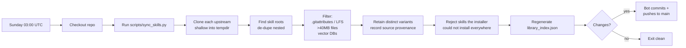

<div align="center">

# 🧬 awesome-skills

**A curated, auto-synced collection of 2,200+ agent skills for Claude Code and Codex CLI** — covering AI4Protein, bioinformatics, academic writing, and general dev/productivity workflows.

[](https://awesome.re)
[](LICENSE)
[](https://github.com/FridrichMethod/awesome-skills/actions/workflows/sync-skills.yml)
[](#sources)
[](#sources)
[](https://github.com/FridrichMethod/awesome-skills/commits/main)
[](CONTRIBUTING.md)

```bash
curl -fsSL https://raw.githubusercontent.com/FridrichMethod/awesome-skills/main/install.sh | bash
```

</div>

---

## Why this exists

Agent skills are how you give Claude Code or Codex CLI deep, reusable expertise in a domain — a folder with a `SKILL.md` and supporting scripts. The community has produced thousands of them across dozens of repos, each with their own scope, license, and quality bar.

**awesome-skills** does three things:

1. **Aggregates** the best Claude Code / Codex skills from 17 upstream curated collections — bio/scientific, academic writing, official Anthropic, Google DeepMind, Superpowers, Karpathy, and major community libraries.
2. **Filters** out things that break installs (Git LFS pointers, files >40 MB, bundled vector DBs, stale `.gitattributes`).
3. **Auto-syncs** every Sunday so your skill library stays current without manual work.

The result is one URL + one command that bootstraps a fresh laptop with **2,200+ vetted skills** available through a searchable index and independent client selections, and that keeps them current with incremental git transfers.

---

## Contents

- [Quick install](#quick-install)
  - [How updates work](#how-updates-work)
  - [Flags](#flags)
  - [Env overrides](#env-overrides)
  - [Exit codes](#exit-codes)
  - [Migration and recovery](#migration-and-recovery)
  - [Offline Codex validation](#offline-codex-validation)
  - [From a local clone](#from-a-local-clone)
- [Sources](#sources)
- [Highlights](#highlights)
  - [AI4Protein / structural biology](#ai4protein--structural-biology)
  - [Journal & paper writing](#journal--paper-writing)
- [Auto-sync workflow](#auto-sync-workflow)
- [Repo layout](#repo-layout)
- [Contributing](#contributing)
- [Security](#security)
- [Licensing](#licensing)
- [Acknowledgements](#acknowledgements)

---

## Quick install

Linux and macOS:

```bash
curl -fsSL https://raw.githubusercontent.com/FridrichMethod/awesome-skills/main/install.sh | bash
```

Native Windows (PowerShell 7; with Windows PowerShell 5.1 use `powershell` in place of `pwsh`):

```powershell
$f = Join-Path ([IO.Path]::GetTempPath()) "awesome-skills-$PID.ps1"
Invoke-WebRequest -UseBasicParsing -Uri https://raw.githubusercontent.com/FridrichMethod/awesome-skills/main/install.ps1 -OutFile $f
pwsh -NoProfile -ExecutionPolicy Bypass -File $f; Remove-Item -LiteralPath $f
```

**The same command is the first install and every update**, on each OS; pass flags after it (`| bash -s -- --dry-run`, or `-File $f --dry-run`). When nothing changed it costs one `git fetch`, writes nothing, and prints `Already current; selection preserved.`

The installer keeps a complete library outside skill discovery and installs independent, persistent selections:

- **Codex starts with one `awesome-skills-library` skill**, whose description tells the model how to search the full library index or enable a source ID. Built-in, plugin, and user skills stay under their existing owners.
- **Claude keeps the full collection by default**, including existing paths. Its selection is independent of Codex. Different-content name collisions are reported and all Claude variants remain available; Codex requires an explicit, unambiguous selection.
- Repeated installs and an updater running `install.sh` **without arguments preserve both clients' choices**. New upstream entries join Claude's default `@all` selection; they do not join Codex's selected collection.

**Requirements:** Python 3.11+ with PyYAML (`python3 -m pip install 'PyYAML>=6.0'`) and **git 2.29 or newer** (**2.37 or newer** with Git for Windows, whose sparse index keeps Windows-invalid paths in unselected skills from blocking checkout). The POSIX bootstrap needs Bash and `curl`; the Windows bootstrap needs PowerShell 7 or Windows PowerShell 5.1 and finds Python as `SKILLS_PYTHON`, then `py -3`, then `python`. A missing or older git fails before anything is written, with a message naming the version found. Installs from a local clone need no network and no git. Use the existing project environment with `SKILLS_PYTHON=/path/to/venv/bin/python` when appropriate. The installer never installs Python dependencies implicitly.

### How updates work

The library is a git partial clone (`--filter=blob:none`) with a cone-mode sparse checkout, kept in the data directory: `${XDG_DATA_HOME:-~/.local/share}/awesome-skills/library` on Linux and macOS, `%LOCALAPPDATA%\awesome-skills\library` on Windows. Nothing lives under a cache directory that cleaners purge.

- **An update fetches only new commits and trees** (the clone holds no file contents beyond what was installed). The full-library index that `--list` and the router read is the committed `library_index.json` (IDs, frontmatter names, descriptions) plus `library_sources.json` (origins), so searching never downloads skill bodies.
- **Change detection is per skill, by git tree id.** Each ownership record stores the tree id it was installed from. A selected skill whose tree id is unchanged and whose directory still exists is skipped after a single `lstat`: nothing is hashed or rewritten. Only skills whose tree changed (or that are missing, newly selected, or deselected) are examined, so destination work is proportional to what changed.
- **Only the blobs of selected skills that changed are downloaded**: the installer narrows the sparse checkout to exactly those skill directories, lets git batch-fetch their missing blobs, copies and verifies them, and narrows the checkout back to `scripts/` and the root files. Unselected skills are never downloaded. Claude's default `@all` selection downloads the whole library once, on its first install.
- **One run at a time**: the installer holds its own lock (`flock` on Linux and macOS, `msvcrt` on Windows) across fetch, planning and apply, and exits `75` when another run holds it. Where `flock` does not work (NFS or Lustre homes without lock support, as on shared cluster login nodes) an exclusive (`O_EXCL`) lock file holding a random token and its start time takes its place; it counts as stale only after 6 hours, and a takeover renames it aside atomically and backs off if the file it moved is not the one it judged stale.
- **A stalled network never holds the lock.** Every git transfer, including blob downloads during checkout, aborts below 1000 bytes/s for 60 s (`GIT_HTTP_LOW_SPEED_LIMIT`/`GIT_HTTP_LOW_SPEED_TIME` override); unless you configured ssh for git, ssh runs with `BatchMode=yes`, `ConnectTimeout=30` and keepalives.
- **Unattended runs heal themselves.** An update killed mid-apply is undone at the start of the next run, which then applies normally; if a file it would restore was edited since, the run exits `3` and names the `--restore` command instead. Under the lock the installer removes stale git `*.lock` files and leftover partial clones; a dropped or stalled transfer is retried once; only a clone that git reports as damaged (not a git repository, bad or unreadable objects, a missing ref) is moved aside (`library.broken-<time>`) and cloned again once, and older broken copies are deleted only after that clone works. A full disk or a slow link is reported, never answered by re-cloning. Inherited `GIT_*` variables (a hook's `GIT_DIR`, `GIT_INDEX_FILE`, injected `GIT_CONFIG_COUNT` config, ...) and system or global git attributes are ignored, so a run started inside another repository never touches it.
- **One bad entry does not stop the rest.** A library entry that cannot be checked out on every platform (a Windows-invalid or reserved name such as `aux` or `a:b`, a case-only twin, a symlink, a submodule, `.gitattributes`/`.gitmodules`) or that is missing from the index is skipped with a warning; an installed copy of it is kept as it is. A skill whose copy fails to prepare or verify is skipped too, the others still update, and the run exits `1` naming it.
- **Native Windows** uses `git -c core.longpaths=true`, extended-length (`\\?\`) paths in Python for deeply nested skills, and plain copies (never links). Executable bits are not representable there and are ignored when comparing content.

### Flags

```bash
./install.sh --codex-only --enable protein-design-workflow
./install.sh --codex-only --enable academic-paper
./install.sh --codex-only --disable academic-paper
./install.sh --list --search protein
```

| Flag | Effect |
|---|---|
| `--claude-only`, `--codex-only` | operate on one client |
| `--enable ID`, `--disable ID` | persistently add/remove a directory source ID; repeatable; requires one client |
| `--selection ID,ID` | replace one client's selection; `--selection ''` disables all managed skills |
| `--list`, `--search TEXT` | inspect the complete library's IDs, frontmatter names, descriptions, tree ids, origins, and conflicts; reads the clone offline as of its last update (a remote `--list` needs an existing install) |
| `--source DIR` | use another local `skills/` tree |
| `--dry-run` | compute the exact plan against the remote tip without writing state or destinations and without moving the clone's checkout; it fetches new commits and trees into an existing clone (a remote dry run needs an existing install). `--list` and `--dry-run` may lazily fetch missing objects into the clone |
| `--allow-mass-removal` | let an update without selection flags remove more than half of a client's managed skills (at least 20); otherwise such an update is refused, since it usually means a broken library |
| `--restore BACKUP` | restore a migration/update transaction; reject later user edits or selection changes |
| `--delete` | deprecated compatibility flag; only verified managed deselections are pruned |
| `-h`, `--help` | print usage |

On PowerShell 5.1, write an empty selection as `--selection=` because that shell drops empty arguments.

IDs refer to directories, but conflicts are checked using frontmatter `name` and git tree ids. Codex deduplicates identical selected aliases while retaining all source IDs and origins in its manifest/cache index. Different-content variants are preserved in the cache and cannot be enabled together for Codex. For Codex, an external skill with the same name and different content also blocks installation before changes are made. Claude keeps every selected variant, reports external conflicts, and preserves user edits. Neither skill names nor catalog ordering are changed.

### Env overrides

| Variable | Default | Effect |
|---|---|---|
| `SKILLS_BRANCH` | `main` | remote branch |
| `SKILLS_REPOSITORY_URL` | `https://github.com/FridrichMethod/awesome-skills.git` | git remote of the library clone |
| `SKILLS_INSTALLER_URL` | `https://raw.githubusercontent.com/FridrichMethod/awesome-skills/$SKILLS_BRANCH/scripts/install_skills.py` | installer the bootstraps download |
| `SKILLS_CLAUDE_DEST` | `$HOME/.claude/skills` | Claude discovery destination |
| `SKILLS_CODEX_DEST` | `$HOME/.codex/skills` | Codex discovery destination |
| `SKILLS_DATA_DIR` | `${XDG_DATA_HOME:-$HOME/.local/share}/awesome-skills` (Windows: `%LOCALAPPDATA%\awesome-skills`) | the library clone (`library/`) |
| `SKILLS_STATE_DIR` | `$HOME/.local/share/awesome-skills` (Windows: `%LOCALAPPDATA%\awesome-skills`) | client selections, ownership manifests, recovery journals/backups, lock |
| `SKILLS_CACHE_DIR` | `$HOME/.cache/awesome-skills` | where the former tarball installer kept snapshots; read only to remove them |
| `SKILLS_PYTHON` | `python3` (Windows: `py -3`, then `python`) | interpreter containing PyYAML |
| `SKILLS_KEEP_BACKUPS` | `5` | transaction backups kept after each update (ordered by a clock-independent stamp; all kept ones are checked for an interrupted update); `0` keeps all |

With `XDG_DATA_HOME` unset, data and state share one directory. State, data and the legacy cache must stay outside discovery, disjoint from install destinations, with no symlink ancestors. Both client destinations must be disjoint, including when updating only one client. Custom destinations are saved for subsequent no-argument updates. State and destinations must share a filesystem for reversible atomic moves; for a custom mount, set `SKILLS_STATE_DIR` to a directory on that mount. The state directory must persist across updater runs. The installer does not edit Codex/Claude configuration, dotfiles, or `~/.agents` configuration.

Consumers that need to know whether the skills are installed can check for the ownership manifests `claude.json`/`codex.json` in the state directory, or for the clone in the data directory; both are written only by successful runs.

When using `curl … | bash`, put env vars on **bash**, or export them first:

```bash
curl -fsSL https://raw.githubusercontent.com/FridrichMethod/awesome-skills/main/install.sh \
  | SKILLS_PYTHON=/path/to/venv/bin/python bash -s -- --codex-only --dry-run
```

### Exit codes

| Code | Meaning |
|---|---|
| `0` | success, including `Already current; selection preserved.` |
| `1` | error, with one message naming the missing tool or failing step; the previous install is left intact |
| `2` | usage error |
| `3` | a person must act: an interrupted update cannot be undone automatically because a file changed since (the message names the `--restore` command), or an update would remove most managed skills (rerun with `--allow-mass-removal` if intended) |
| `75` | another installer run holds the lock (callers may ignore it) |

### Migration and recovery

**From the tarball installer (0.3.x and earlier):** the first run of this version recognizes the existing ownership manifests. A managed copy whose bytes and executable bits equal the library's current tree is recorded with its tree id and **not copied again** (permission differences such as tarball `0664` modes do not count); modified managed copies stay preserved as before. The old router, which pointed into the cache, is replaced. Once no managed router comes from the old installer, the snapshot directories it created under `~/.cache/awesome-skills/libraries/` (recognized by their 64-hex names and exact layout) are removed; nothing else there is touched. The first run downloads the blobs of selected skills once, then later runs are incremental.

Preview a change before applying it, and undo a transaction:

```bash
./install.sh --codex-only --dry-run > codex-plan.json
# Review the exact actions, before/after hashes, and preserved entries in that file.
./install.sh --codex-only
# The installer prints a transaction BACKUP directory. Restore it with:
./install.sh --restore BACKUP --dry-run
./install.sh --restore BACKUP
```

A directory without a manifest is adopted **only when it is selected and its entire directory matches the current library tree**, including support files, extra/missing files, permissions (`0644`/`0755` files, `0755` directories as this installer writes them), and symlink targets; it is then recorded instead of copied again. A directory name alone is insufficient. An unmanaged directory that is not selected is never adopted or removed, even when identical to a library skill, so copies left by pre-manifest installers stay in place for you to remove; older copies differing from the library also remain untouched. Manifested copies are movable only if their recorded fingerprint still matches. Modified managed copies retain their old fingerprint so repeated updates continue to preserve them.

Hidden entries such as Codex's own `.system` and every top-level symlink (and, on Windows, junction) are protected; no skill name is reserved. Unknown and modified entries are reported and preserved. No operation runs `rsync --delete` over a skills root. Removed or replaced owned directories are moved into a transaction backup, with old client state recorded before live changes. Replacements are fully prepared and verified first. Restore preserves unrelated entries and refuses to overwrite later user changes. A run interrupted while downloading or preparing copies changes nothing live and does not block later runs; one interrupted while moving entries is rolled back at once, or by the next run. The newest `SKILLS_KEEP_BACKUPS` (default 5) finished backups are kept; older ones are pruned after each update.

Preserving unverifiable legacy skills can leave discovery overloaded. Inspect the plan and use your own backups/provenance to resolve those entries; the installer does not infer ownership or silently delete them. External/plugin collections can also exceed Codex limits independently of this repository. Restart Codex after selection changes, then verify its actual model catalog.

### Offline Codex validation

```bash
SKILLS_PYTHON=/path/to/venv/bin/python \
  /path/to/venv/bin/python -B scripts/verify_codex_catalog.py
```

The verifier detects the installed version and available debug/protocol features, runs discovery and prompt preview in a temporary HOME with no credentials, and compares a legacy fixture with the migrated selection. It checks the names **and descriptions** of two fixture skills outside the library (one linked into the temporary `~/.agents/skills`) in the actual model-visible catalog, traversal warnings, and a no-argument updater rerun. It disables remote plugins/apps and blocks network proxies, invokes no model, and cleans its temporary environment. Unsupported debug interfaces are reported explicitly; discovery counts and rendering limits are measured, not hard-coded. Counts can differ because Codex intentionally hides some discovered system skills.

### From a local clone

`./install.sh` (or `.\install.ps1`) in a complete checkout installs from the adjacent `skills/` tree and needs neither network nor git; the router then points at that checkout. A sparse checkout, or the managed library clone itself, is refused as a local source. After a remote install, the helper inside the data directory serves the managed clone, offline for `--list`:

```bash
python3 -B ~/.local/share/awesome-skills/library/scripts/install_skills.py --list --search protein
python3 -B ~/.local/share/awesome-skills/library/scripts/install_skills.py --codex-only --enable SOURCE_ID
```

To regenerate `library_index.json` after editing `skills/` by hand, run `python scripts/sync_skills.py --index-only`; CI checks that it matches.

---

## Sources

Skills are aggregated from these upstream repositories — credit and gratitude to the original authors. Sources are grouped by scope; within `scripts/sync_skills.py` every observed origin is recorded in `library_sources.json`. Currently **17 sources**.

### Bio / scientific / medical

| Source | Stars | Skills | Focus |
|---|---:|---:|---|
| [K-Dense-AI/claude-scientific-skills](https://github.com/K-Dense-AI/claude-scientific-skills) | 23.4k | ~137 | Scientific computing, bioinformatics, cheminformatics |
| [K-Dense-AI/claude-scientific-writer](https://github.com/K-Dense-AI/claude-scientific-writer) | 1.8k | ~81 | Scientific writing, citations, posters |
| [google-deepmind/science-skills](https://github.com/google-deepmind/science-skills) | 1.8k | 37 | **Google DeepMind** curated science skills — genomics, structural biology, cheminformatics, literature search, biological databases (Apache 2.0) |
| [FreedomIntelligence/OpenClaw-Medical-Skills](https://github.com/FreedomIntelligence/OpenClaw-Medical-Skills) | 2.5k | ~868 | Medical AI, clinical genomics, drug discovery |
| [GPTomics/bioSkills](https://github.com/GPTomics/bioSkills) | 667 | ~475 | Bioinformatics (variant, CRISPR, single-cell, spatial) |
| [jaechang-hits/SciAgent-Skills](https://github.com/jaechang-hits/SciAgent-Skills) | 158 | 199 | Life-science workflows (BixBench 92%) |
| [adaptyvbio/protein-design-skills](https://github.com/adaptyvbio/protein-design-skills) | 127 | 21 | **Protein design pipeline**: BoltzGen, Chai, RFdiffusion, ProteinMPNN |

### Academic / writing

| Source | Stars | Skills | Focus |
|---|---:|---:|---|
| [Imbad0202/academic-research-skills](https://github.com/Imbad0202/academic-research-skills) | 8.6k | 4 | Academic research→write→review pipeline |
| [lishix520/academic-paper-skills](https://github.com/lishix520/academic-paper-skills) | 624 | 2 | Paper strategist + composer |
| [jamditis/claude-skills-journalism](https://github.com/jamditis/claude-skills-journalism) | 209 | 53 | Journalism, FOIA, fact-checking, academic writing |
| [Yuan1z0825/nature-skills](https://github.com/Yuan1z0825/nature-skills) | 13k | 9 | **Nature journal** writing, polishing, figures, citations, peer-review response |
| [AIScientists-Dev/academic-humanizer](https://github.com/AIScientists-Dev/academic-humanizer) | 485 | 1 | De-AI academic prose & grant proposals (NSF/NIH) — preserve scholarly voice, tie claims to evidence, never touch numbers/citations |

### General-purpose & foundational

| Source | Stars | Skills | Focus |
|---|---:|---:|---|
| [wshobson/agents](https://github.com/wshobson/agents) | 35.5k | 155 | Production dev workflows — accessibility, code review, deployment, testing across many plugin domains |
| [anthropics/claude-plugins-official](https://github.com/anthropics/claude-plugins-official) | 19.5k | 28 | **Official Anthropic** plugin skills — Discord, iMessage, Slack, Telegram, GitHub messaging & access |
| [forrestchang/andrej-karpathy-skills](https://github.com/forrestchang/andrej-karpathy-skills) | 133.3k | 1 | Andrej Karpathy's CLAUDE.md packaged — guidance for fixing common LLM coding pitfalls |
| [anthropics/skills](https://github.com/anthropics/skills) | 136.1k | 18 | **Official Anthropic** skills — algorithmic-art, brand-guidelines, canvas-design, claude-api, doc-coauthoring, mcp-builder, pdf, pptx, xlsx, etc. |
| [obra/superpowers](https://github.com/obra/superpowers) | 194.6k | 14 | Anthropic-blessed methodology framework — brainstorming, TDD, debugging, planning, code review, subagent-driven dev |

> Sync preserves different-content same-name variants under source-qualified directory IDs, records their origins and conflicts, and never changes their frontmatter names. Identical variants can share content with all observed origins retained. Legacy entries have unknown upstream provenance until observed; historical variants lost by the former overwrite policy cannot be reconstructed from this checkout.

---

## Highlights

### AI4Protein / structural biology

<details open>
<summary><strong>Click to expand</strong></summary>

| Category | Skills |
|---|---|
| **Generation / design** | `boltzgen` · `rfdiffusion` · `proteinmpnn` · `ligandmpnn` · `solublempnn` · `bindcraft` · `binder-design` · `generative-design` |
| **Structure prediction** | `alphafold` · `alphafold-predictions` · `chai` · `boltz` · `foldseek` · `modern-structure-prediction` · `protein-structure-prediction` |
| **Language models** | `esm` · `esm-protein-language-model` |
| **QC / validation** | `protein-qc` · `pose-validation` · `protein-design-workflow` · `binding-characterization` |
| **Antibody / therapeutics** | `antibody-design-agent` · `mage-antibody-generator` · `tooluniverse-antibody-engineering` · `tooluniverse-protein-therapeutic-design` |
| **Databases** | `uniprot-database` · `alphafold-database` · `pdb-database` · `chembl-database` · `drugbank-database` · `interpro-database` · `pubchem-database` |

</details>

### Journal & paper writing

<details open>
<summary><strong>Click to expand</strong></summary>

| Category | Skills |
|---|---|
| **Pipelines** | `academic-paper` · `academic-paper-reviewer` · `academic-pipeline` · `deep-research-swarm` · `composer` · `strategist` |
| **Drafting** | `scientific-writing` · `scientific-manuscript-writing` · `academic-writing` · `academic-humanizer` · `article-writing` · `peer-review-methodology` |
| **Citation / lit search** | `pubmed-database` · `biorxiv-database` · `medrxiv-search` · `literature-review` · `citation-management` · `paperzilla` |
| **Figures** | `latex-posters` · `latex-research-posters` · `scientific-schematics` · `scientific-visualization` · `markdown-mermaid-writing` · `pptx-posters` |
| **Venue figure guides** | `nature-figure-guide` · `cell-figure-guide` · `science-figure-guide` · `lancet-figure-guide` · `nejm-figure-guide` · `pnas-figure-guide` · `elife-figure-guide` · `cancer-research-figure-guide` |
| **Nature journal** | `nature-figure` · `nature-polishing` · `nature-writing` · `nature-citation` · `nature-data` · `nature-reader` · `nature-response` · `nature-paper2ppt` · `nature-academic-search` |

</details>

---

## Auto-sync workflow

A weekly GitHub Actions workflow ([`.github/workflows/sync-skills.yml`](.github/workflows/sync-skills.yml)) keeps the repo current:



**Trigger it manually:**

```bash
gh workflow run sync-skills.yml -R FridrichMethod/awesome-skills
```

Or via the [Actions tab](https://github.com/FridrichMethod/awesome-skills/actions/workflows/sync-skills.yml) → **Run workflow**.

Each successful run posts a per-source change summary table in the job summary.

---

## Repo layout

```
awesome-skills/
├── skills/                          ← 2,233 skill dirs (managed by sync; do not edit directly)
├── install.sh                       ← one-line installer and updater (curl|bash compatible)
├── install.ps1                      ← the same for native Windows PowerShell
├── scripts/
│   ├── sync_skills.py               ← aggregation + provenance + library index
│   ├── install_skills.py            ← git transport + selection + ownership + recovery
│   └── verify_codex_catalog.py      ← offline model-catalog verification
├── tests/                           ← temporary-HOME contract tests (file:// git remote)
├── library_index.json               ← every skill's ID, name and description (generated)
├── library_sources.json             ← observed origins and conflicts
├── .github/
│   ├── workflows/sync-skills.yml    ← weekly auto-sync
│   ├── ISSUE_TEMPLATE/              ← new-source · broken-skill · installer-bug
│   ├── PULL_REQUEST_TEMPLATE.md
│   └── dependabot.yml
├── README.md
├── CONTRIBUTING.md
├── CODE_OF_CONDUCT.md
├── SECURITY.md
├── CHANGELOG.md
├── LICENSE
├── .pre-commit-config.yaml
└── .editorconfig
```

---

## Contributing

PRs, issue reports, and source suggestions are all welcome. **Don't edit files inside `skills/` directly** — those are managed by the weekly sync. See [CONTRIBUTING.md](CONTRIBUTING.md) for the full workflow, including how to:

- Suggest a new upstream source ([template](.github/ISSUE_TEMPLATE/new-source.yml))
- Report a broken skill ([template](.github/ISSUE_TEMPLATE/broken-skill.yml))
- Report an installer / workflow bug ([template](.github/ISSUE_TEMPLATE/installer-bug.yml))
- Test the installer and sync script locally

Setup hooks once:

```bash
pip install pre-commit && pre-commit install
```

---

## Security

Found a vulnerability in the installer, sync script, or workflows? Please disclose privately via [GitHub Security Advisories](https://github.com/FridrichMethod/awesome-skills/security/advisories/new) — see [SECURITY.md](SECURITY.md).

Vulnerabilities in *upstream skill content* should be reported to the source repo (see the [Sources](#sources) table).

---

## Licensing

The curation, installer, and workflows in this repo are released under the [MIT License](LICENSE).

**Skill content inside `skills/` retains its upstream license.** Each `skills/<name>/` directory may carry its own `LICENSE`, `README.md`, or inline notice from the original author. Review them before commercial reuse.

---

## Acknowledgements

This project would not exist without the work of:

**Bio / scientific / medical**

- [K-Dense AI](https://github.com/K-Dense-AI) for the scientific-skills + scientific-writer collections
- [FreedomIntelligence](https://github.com/FreedomIntelligence) for OpenClaw Medical Skills
- [GPTomics](https://github.com/GPTomics) for bioSkills
- [Jaechang Hits](https://github.com/jaechang-hits) for SciAgent-Skills
- [Google DeepMind](https://github.com/google-deepmind) for [science-skills](https://github.com/google-deepmind/science-skills) — genomics, structural biology, cheminformatics, literature search, and biological-database skills
- [Adaptyv Bio](https://github.com/adaptyvbio) for the protein-design pipeline skills

**Academic / writing**

- [Imbad0202](https://github.com/Imbad0202) and [lishix520](https://github.com/lishix520) for the academic paper pipelines
- [Yuan1z0825](https://github.com/Yuan1z0825) for [nature-skills](https://github.com/Yuan1z0825/nature-skills) — Nature journal writing, polishing, figures, citations, and peer-review response
- [AIScientists-Dev](https://github.com/AIScientists-Dev) for [academic-humanizer](https://github.com/AIScientists-Dev/academic-humanizer) — de-AI-ing academic prose and grant proposals while preserving scholarly voice and evidence-bound claims
- [Joe Amditis](https://github.com/jamditis) for the journalism skills

**General-purpose / foundational**

- [Jesse Vincent (obra)](https://github.com/obra) for [Superpowers](https://github.com/obra/superpowers) — the methodology framework that anchors how skills get built
- [Anthropic](https://github.com/anthropics) for the [official skills](https://github.com/anthropics/skills) and [plugins-official](https://github.com/anthropics/claude-plugins-official) directories
- [Andrej Karpathy](https://karpathy.ai/) (via [forrestchang](https://github.com/forrestchang/andrej-karpathy-skills)) for the famous CLAUDE.md
- [wshobson](https://github.com/wshobson) for the [agents](https://github.com/wshobson/agents) multi-plugin collection
- The [Anthropic Claude Code](https://docs.claude.com/en/docs/claude-code) team for designing the SKILL.md format

If you use this repo and find it useful, ⭐ the upstream sources, not just this one.

<p align="right"><a href="#-awesome-skills">↑ back to top</a></p>
